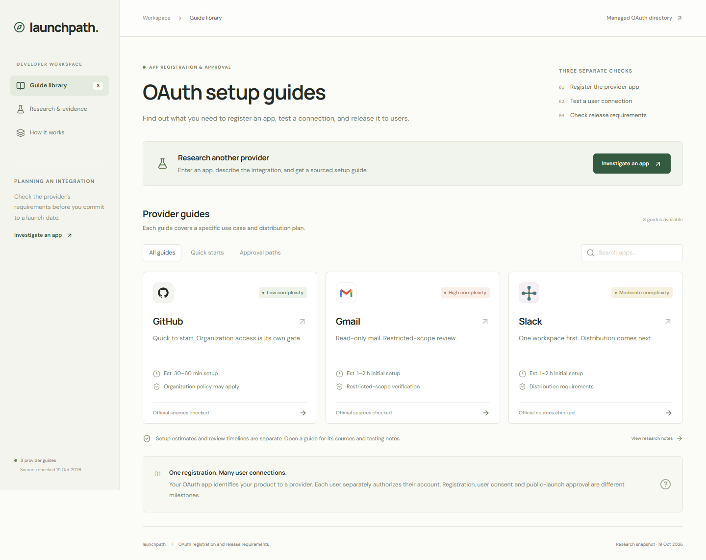

# Launchpath

An OAuth setup navigator for agent builders: know the work, the wait, and your next action.

- **Working preview:** https://oauth-launchpath.shahilsunny2104.chatgpt.site
- **Source:** https://github.com/vermashahil45/oauth-launchpath

Both links are private. Grant reviewer access before submission.



## What works

Three researched guides cover GitHub public-profile access, Gmail restricted mailbox access, and Slack development/pilot/Marketplace distribution. Search and filter the library; follow a device-local checklist; inspect blockers, sources, uncertainty and agent/human handoffs; share a stable URL or export Markdown.

The live-generation implementation accepts an app name or website, use case and audience. It runs a web-research agent, compiles a structured guide, validates source references and returned source/action URLs, and saves a D1 record with a shareable URL. Progress reflects actual server stages.

**Outstanding:** live generation is not enabled or verified because the server model credential is not configured. The app returns an explicit configuration error, not a canned result. This central demo check remains before submission.

## Setup

Requires Node.js 22.13+ (24 recommended), npm and network access.

```bash
npm ci
npm run db:local
cp .env.example .dev.vars
# Add your API credential to the ignored .dev.vars file in your editor.
npm run dev
```

PowerShell: use `Copy-Item .env.example .dev.vars`. Open the printed local URL, normally port 5173.

```bash
npm run check
npm run typecheck
npm run build
```

Configure `OPENAI_API_KEY` privately in `.dev.vars` locally and as a secret runtime value in Sites for deployment. `OPENAI_MODEL` defaults to `gpt-5.4`; the account needs model/web-search access and API credit. Redeploy after changing hosted variables. Never commit credentials.

Uses the supplied Sites Vinext/React starter and Cloudflare D1. `.openai/hosting.json` declares `DB`; Sites applies the versioned Drizzle migrations during deployment. Local and hosted databases are separate.

## Key decisions

- **Specific scenarios:** difficulty depends on permissions, audience and distribution, not just the provider name.
- **Work versus waiting:** hands-on estimates are labeled; external timing is sourced or unknown.
- **Evidence in the workflow:** documentation, observed public entry points, estimates and untested steps are explicit.
- **Bounded agent:** research and preparation are automated. Authentication, domain proof, credential handling and review submissions belong to a human.
- **A focused slice:** three contrasting guides and an extensible schema demonstrate the eventual 100-app library without shallow filler.

## Verification and limits

TypeScript, the production build, local migration, deterministic research checks and desktop/mobile browser checks passed. Hosted checks passed for the page, seeded API, database-backed lookup, origin protection and missing-secret response. See [full results](docs/verification-results.md).

No provider registration, consent, token exchange or approval was completed. Public console entry attempts and corrected assumptions are recorded in [validation notes](docs/validation.md). Hands-on durations are estimates, not measurements.

Generated guides are AI research drafts. Citation membership does not prove claim accuracy, full-page reading or source authority. The prompt prefers official sources; there is no universal provider-domain allowlist. Research has a three-minute timeout and a global allowance of 30 attempts per UTC day, including failures. There is no background queue, autonomous registration or freshness scheduler.

Generated records are visible to people with site access. Do not submit confidential use cases. Checklists stay on the device; current-session generated cards reset on reload while saved guide URLs persist.

## Review the implementation

- `lib/guides.ts`: curated guidance and sources.
- `lib/guide.ts`: runtime guide contract.
- `lib/research.ts`: research instructions, compilation and evidence checks.
- `app/api/research/route.ts`: validation, quota, streaming and persistence.
- `components/launchpath.tsx`: library, guide and research interface.
- [Demo walkthrough](docs/demo.md).
